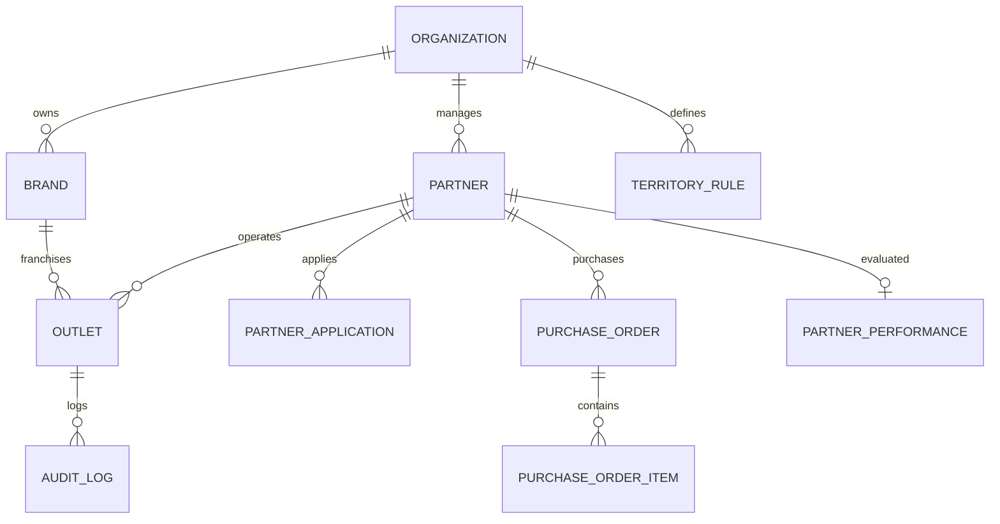

# Melatea Partner Center — Database Schema & Architecture

## 1. Overview
Database dirancang untuk mendukung multi-tenant B2B Franchise Management dengan PostGIS spatial capabilities, pemantauan repeat order, klasifikasi performa mitra, dan audit logging yang ketat.

---

## 2. Entity Relationship Diagram (Mermaid)



---

## 3. Entitas Utama

### `Organization` (Tenant Root)
- `id` (String, UUID/CUID, PK)
- `name` (String, e.g. "PT Melatea Nusantara Indonesia")
- `code` (String, e.g. "MELATEA-HQ")
- `createdAt`, `updatedAt`

### `Brand`
- `id` (String, PK)
- `organizationId` (String, FK -> Organization)
- `name` (String, e.g. "Es Teh Melatea")
- `code` (String, e.g. "ESTEH-MELATEA")
- `primaryColor` (String, default: "#71379B")
- `deepColor` (String, default: "#29183B")

### `Partner` (Mitra Franchise)
- `id` (String, PK, e.g. "PTR-001")
- `organizationId` (String, FK -> Organization)
- `ownerName` (String, Nama Pemilik)
- `email` (String)
- `phone` (String, Nomor WhatsApp)
- `identityNumber` (String, NIK/KTP)
- `tier` (Enum: UNGGULAN, REGULER, PERLU_PERHATIAN, TIDAK_AKTIF)
- `joinedAt` (DateTime)
- `status` (Enum: ACTIVE, SUSPENDED, INACTIVE)

### `Outlet` (Gerai / Cabang Kemitraan)
- `id` (String, PK, e.g. "OUT-001")
- `partnerId` (String, FK -> Partner)
- `brandId` (String, FK -> Brand)
- `name` (String, e.g. "Melatea Outlet Manahan Solo")
- `address` (String, Alamat Lengkap)
- `city` (String, e.g. "Surakarta")
- `district` (String, e.g. "Banjarsari")
- `latitude` (Float, e.g. -7.5532)
- `longitude` (Float, e.g. 110.8061)
- `location` (Unsupported("geography(Point, 4326)"), PostGIS Point)
- `operationalDate` (DateTime)
- `status` (Enum: ACTIVE, ATTENTION, INACTIVE, CANDIDATE)

### `PartnerApplication` (Pengajuan Lokasi Baru)
- `id` (String, PK, e.g. "APP-2026-001")
- `partnerId` (String, FK -> Partner)
- `applicantName` (String)
- `proposedOutletName` (String)
- `proposedAddress` (String)
- `latitude` (Float)
- `longitude` (Float)
- `minimumRadiusKm` (Float, default 3.0)
- `feasibilityStatus` (Enum: LAYAK, TIDAK_LAYAK, PERLU_REVIEW)
- `nearestOutletDistanceMeters` (Float)
- `conflictingOutletIds` (String[], array of outlet IDs)
- `workflowStatus` (Enum: DRAFT, SUBMITTED, LOCATION_CHECKED, REVIEW, APPROVED, REJECTED)
- `reviewerNotes` (String)
- `reviewedBy` (String)
- `reviewedAt` (DateTime)

### `TerritoryRule` (Aturan Radius Proteksi Wilayah)
- `id` (String, PK)
- `organizationId` (String, FK -> Organization)
- `city` (String, default: "ALL")
- `protectionRadiusKm` (Float, default: 3.0)
- `allowException` (Boolean, default: true)
- `active` (Boolean, default: true)

### `PurchaseOrder` (Transaksi B2B dari Mitra ke Pusat)
- `id` (String, PK, e.g. "PO-2026-04-001")
- `partnerId` (String, FK -> Partner)
- `outletId` (String, FK -> Outlet, opsional)
- `orderDate` (DateTime)
- `totalAmount` (Float)
- `orderStatus` (Enum: COMPLETED, PROCESSING, CANCELLED, FAILED)
- `isFirstOrder` (Boolean, true jika order paket awal modal kemitraan)
- `isRepeatOrder` (Boolean, true jika restock rutin bahan baku)

### `PurchaseOrderItem` (Item Produk B2B)
- `id` (String, PK)
- `orderId` (String, FK -> PurchaseOrder)
- `productName` (String, e.g. "Teh Melatea Premium Blend 1kg")
- `quantity` (Int)
- `unitPrice` (Float)
- `subtotal` (Float)

### `PartnerPerformance` (Metrik RFM & Evaluasi Mitra)
- `id` (String, PK)
- `partnerId` (String, FK -> Partner, unique)
- `totalSpend` (Float, Lifetime B2B spend)
- `totalOrders` (Int)
- `repeatOrderCount` (Int, total repeat order tidak termasuk order awal)
- `averageOrderValue` (Float)
- `firstOrderAt` (DateTime)
- `lastOrderAt` (DateTime)
- `daysSinceLastOrder` (Int)
- `orderIntervalDays` (Float, rata-rata interval antar transaksi)
- `performanceScore` (Float, 0 - 100)
- `category` (Enum: UNGGULAN, REGULER, PERLU_PERHATIAN, TIDAK_AKTIF)

### `AuditLog` (Rekam Jejak Kemanan & Approval)
- `id` (String, PK)
- `organizationId` (String)
- `action` (String, e.g. "APPLICATION_APPROVED", "TERRITORY_VALIDATED")
- `entityType` (String)
- `entityId` (String)
- `actorName` (String)
- `metadata` (JSON)
- `createdAt` (DateTime)

---

## 4. PostGIS Query Reference
```sql
-- Validasi Jarak Wilayah (Metode Geography Akurat Jarak Geodesic)
SELECT id, name, latitude, longitude,
       ST_Distance(
         location,
         ST_SetSRID(ST_MakePoint(:targetLng, :targetLat), 4326)::geography
       ) AS distance_meters
FROM "Outlet"
WHERE "organizationId" = :orgId
  AND status = 'ACTIVE'
  AND ST_DWithin(
        location,
        ST_SetSRID(ST_MakePoint(:targetLng, :targetLat), 4326)::geography,
        :radiusMeters
      )
ORDER BY distance_meters ASC;
```
